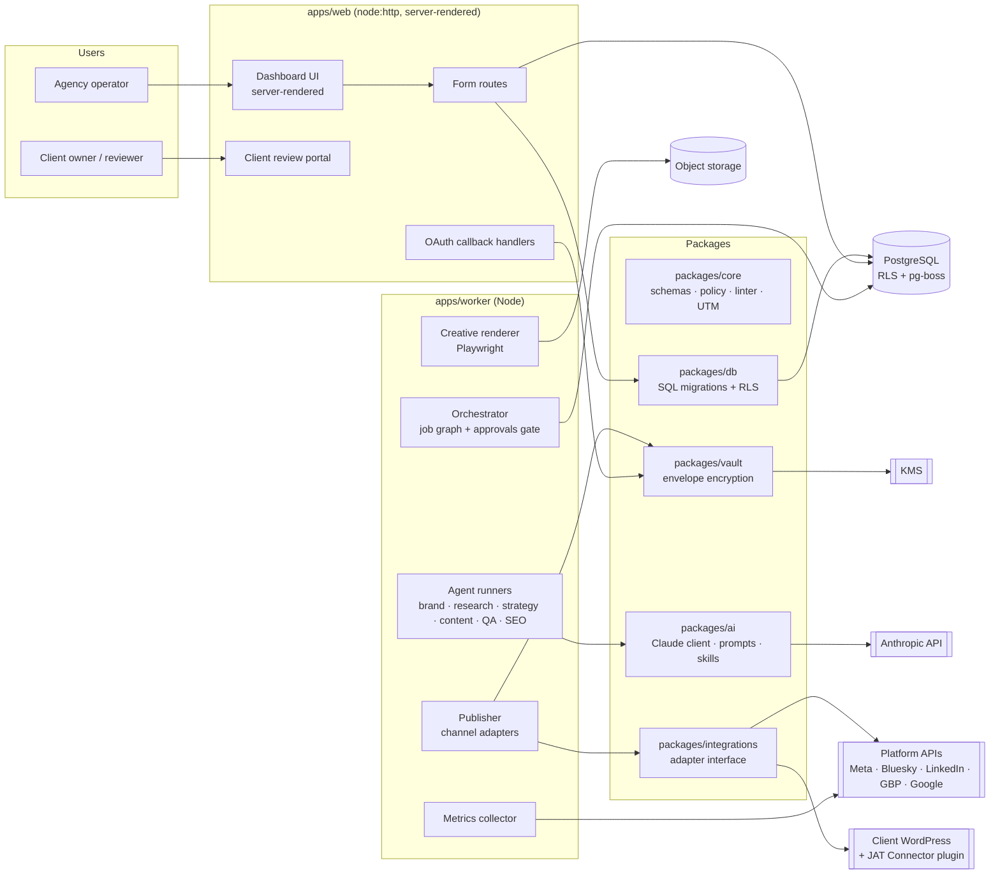
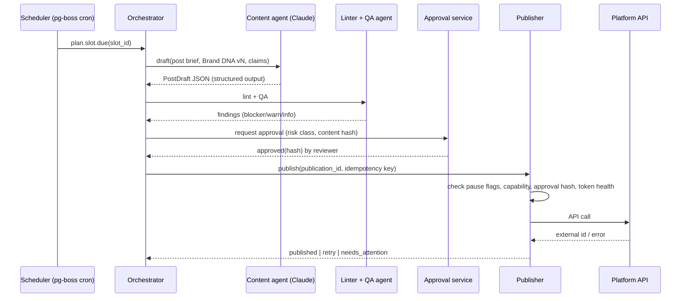

# B — Technical Architecture

## 1. Guiding decisions

| Decision | Choice | Why | Rejected alternatives |
|---|---|---|---|
| Language | **TypeScript everywhere** (Node 22 LTS) | One language for UI, API, workers, schemas; zod schemas shared between AI output validation and API validation | Python workers (second toolchain for a small team) |
| Repo | **pnpm monorepo** | Shared `core` domain package; atomic changes across web/worker | Polyrepo |
| Web | **Server-rendered HTML on `node:http`, no framework** (MVP, built Oct 2026) | Zero runtime dependencies, no client JavaScript, strict CSP (`default-src 'none'`), forms + redirects work everywhere; every view is a typed function returning escaped HTML. Revisit **Next.js** when the planner/calendar needs rich client interactivity (drag-and-drop) | Next.js first (more moving parts; also couldn't be installed in the build sandbox, which had no npm registry access) |
| Database | **PostgreSQL 16+ with Row-Level Security** | Tenant isolation enforced by the database; JSONB for Brand DNA; mature backups | Separate DB per tenant (ops overhead), MongoDB |
| Data access | **SQL-first migrations** now; **Drizzle** typed query layer from Phase 2 | RLS policies, triggers and grants are clearest as reviewed SQL; Drizzle stays SQL-close and works with transaction-local settings | Prisma (RLS + session variables are awkward) |
| Jobs | **pg-boss** (Postgres-backed queue) | Cron, retries, backoff, singleton keys, no Redis to run in MVP; jobs are transactional with domain writes | BullMQ + Redis (add later if throughput needs it), n8n (see review §2 #9), Temporal (heavy for MVP) |
| Object storage | **S3-compatible** (Cloudflare R2 or AWS S3) | Brand assets, rendered creatives, export packages; signed URLs for platforms that require public media URLs | DB blobs |
| AI | **Anthropic Messages API** with native structured outputs, prompt caching, Batches for bulk jobs | Deterministic JSON contracts per agent; cost control | Managed Agents for tenant data (not ZDR-eligible, $0.08/session-hr); Agent SDK in production (full Claude Code harness is more power than a tenant job should have) |
| Secrets | **Envelope encryption**: a fresh AES-256-GCM data key per secret, wrapped by a KMS key (AWS KMS / GCP KMS; local key in dev); AAD binds each ciphertext to tenant + integration | Copied rows can't be decrypted under another tenant; KEK rotation only re-wraps data keys | Plain env vars, DB encryption only |
| Auth | Magic links (hashed, single-use, 15 min; issued by SECURITY DEFINER functions) + HMAC-signed session cookie with revocation epoch; OIDC later | Clients review without passwords; small, auditable surface | Auth.js (needs Next.js) |
| Rendering | HTML/CSS templates → PNG via headless Chromium (Playwright) in the worker | Exact typography & brand tokens; text never drawn by an image model | AI image models for text |
| Hosting (MVP) | Managed Postgres (e.g. Neon/RDS) + 2 containers (web, worker) on Fly.io/Render/ECS + R2 | ~$60–150/mo total at pilot scale, no Kubernetes | Self-hosted k8s |

## 2. Component diagram



## 3. System boundaries

1. **Web tier never calls external platforms for publishing.** It enqueues jobs. This keeps one place (the worker) responsible for idempotency, rate limits and audit.
2. **Agents never hold platform credentials.** AI runners produce *proposals* (JSON). Only the Publisher, after the approval gate, decrypts a credential — and only for the duration of one call.
3. **The approval gate is code, not a prompt.** `packages/core/policy` decides whether an action needs approval; agents cannot override it.
4. **Every tenant-scoped query runs inside a transaction that sets `app.tenant_id`.** RLS policies reject rows from other tenants even if application code forgets a `WHERE`.
5. **The WordPress plugin is a separate trust domain.** It verifies HMAC-signed requests, applies least-privilege capabilities, and keeps its own local snapshot log so rollback works even if the platform is unreachable.

## 4. Key data flows

### 4.1 Content creation to publication



### 4.2 Brand DNA extraction
URL crawl (robots-respecting, ≤50 pages) + PDF text/image extraction → chunked evidence store → Brand agent produces `BrandDnaProposal` where **each field carries `{value, sources[], confidence, status}`** → diff against prior version → human approval → new immutable version.

### 4.3 WordPress write
Platform → (HMAC-signed, Application Password auth) → JAT Connector `/jat/v1/posts/{id}/seo` → plugin snapshots current values → writes via SEO-plugin-specific adapter (Yoast/Rank Math/AIOSEO) → returns `change_id`. Rollback: `/jat/v1/changes/{change_id}/rollback`.

## 5. Agent runtime model

Agents are **functions with contracts**, not autonomous processes:

```
runAgent(agent: AgentDefinition, input: Input, ctx: TenantContext) -> Result<Output, AgentError>
```

- `AgentDefinition` = system prompt (from the agent's skill folder), zod input/output schema, allowed tools (e.g., `web_search` with `allowed_domains`, `web_fetch`), model tier, max tokens, cost budget.
- Output is requested via **structured outputs** (`output_config.format`) and re-validated with zod (zod enforces lengths/ranges structured outputs can't).
- The Brand DNA and claim registry are placed in a cached system block (`cache_control`) so repeated generations for one tenant reuse the cache.
- Bulk, non-urgent jobs (monthly plans, re-audits) use the **Message Batches API** (50% discount).
- Every run writes an `agent_runs` row: model, tokens in/out/cached, cost, latency, input hash, output, findings.

The same skill folders (`skills/*/SKILL.md`) are used by engineers in **Claude Code** during development and can be uploaded via `POST /v1/skills` if we later run them in the code-execution container. See `C-claude-skills-architecture.md`.

## 6. Channel adapter interface

```ts
interface ChannelAdapter {
  channel: Channel;
  capabilities(conn: Connection): Promise<CapabilitySet>;   // live, per connection
  validate(post: PublishablePost): ValidationResult;        // platform limits
  publish(post: PublishablePost, ctx: PublishContext): Promise<PublishResult>;
  schedule?(post, at, ctx): Promise<PublishResult>;          // only if native scheduling
  delete?(externalId, ctx): Promise<void>;                   // incident response
  fetchMetrics?(externalIds, range, ctx): Promise<MetricPoint[]>;
  exportPackage(post): Promise<ExportItem>;                  // always available
}
```

The capability registry drives the UI and planner: if `capabilities()` lacks `publish:image`, the slot is produced as an export package automatically.

## 7. Environments

| Env | Data | Platform apps | AI keys | Notes |
|---|---|---|---|---|
| `local` | seed data, local/Docker Postgres 16 | sandbox/test apps only | dev key with low spend limit | `PUBLISH_MODE=dry_run` forced |
| `staging` | synthetic tenants | test pages/accounts owned by JAT | staging key | real APIs, JAT-owned accounts only |
| `production` | client data | reviewed apps | prod key, workspace spend limit | `PUBLISH_MODE=live` requires flag per tenant |

`PUBLISH_MODE` defaults to `dry_run` in all environments; production publishing requires both the env setting and a per-tenant `publishing_enabled` flag set by a Platform Admin (Implementation Rule #8).

## 8. Observability
Structured JSON logs (pino) with `tenant_id`, `job_id`, `agent_run_id`; OpenTelemetry traces; error tracking (Sentry). Dashboards: publish success rate, queue depth, AI spend per tenant per day, token refresh failures, API quota headroom.

## 9. Scaling path
Single Postgres handles pilot through hundreds of tenants. When queue throughput or cron fan-out becomes a bottleneck: move hot queues to BullMQ/Redis, add read replica for reporting, split renderer into its own service. Keep the adapter interface stable so these are deployment changes, not rewrites.
