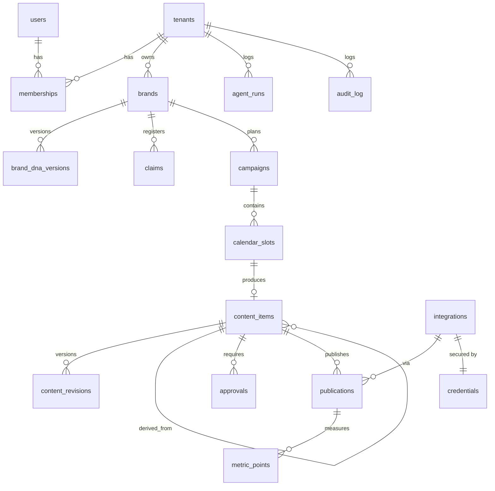

# E — Database Design

PostgreSQL 16+. The executable source of truth is `packages/db/migrations/0001_init.sql` (a Drizzle typed layer will mirror it in Phase 2). This document explains the model.

## 1. Tenancy model

- **Shared database, shared schema, `tenant_id` on every tenant-owned row**, enforced by **Row-Level Security**.
- The application connects as role `app_user` (no `BYPASSRLS`). Each request/job runs in a transaction that executes `SELECT set_config('app.tenant_id', $1, true)`.
- Policy on each tenant table: `USING (tenant_id = current_setting('app.tenant_id', true)::uuid)` with the same `WITH CHECK`. An unset tenant matches nothing (fail closed).
- `FORCE ROW LEVEL SECURITY` is enabled so even the table owner is subject to policies; migrations run as a separate `migrator` role.
- Platform-level tables: `tenants` (the app can read its own row and update only operational columns — name, mode, pause; gating flags like `publishing_enabled`, `autonomous_eligible` and budgets are admin-only), `users` (read: yourself and members of the current workspace; created by invitation tooling), `platform_settings` (read-only to the app; global pause is admin-only).
- Roles: `app_user` (web + worker, no credential reads), `publisher_user` (inherits `app_user` and may read/update `credentials`), and the migration owner. None has `BYPASSRLS`.
- Append-only by grant: `content_revisions`, `approvals`, `audit_log`, `agent_runs` (AI cost ledger). `brand_dna_versions` cannot be deleted and active versions are immutable (trigger).
- Cross-row integrity uses composite foreign keys that include `tenant_id` (and the owning item), so a row can never reference another tenant's — or another item's — data.

## 2. Entity overview



## 3. Tables (summary)

| Table | Key columns | Notes |
|---|---|---|
| `tenants` | id, name, slug, automation_mode (`manual`/`assisted`/`autonomous`), publishing_enabled, paused_at, monthly_ai_budget_cents | Mode and kill-switch live here |
| `users` | id, email, name, session_epoch | `session_epoch` revokes all sessions on sign-out |
| `memberships` | tenant_id, user_id, role (`agency_operator`,`client_owner`,`client_editor`,`reviewer`) | Platform admins are not tenant members; managed by admin tooling |
| `brands` | tenant_id, name, active_dna_version_id | A tenant may run multiple brands (multi-location) |
| `brand_dna_versions` | tenant_id, brand_id, version, status (`proposed`/`active`/`superseded`/`rejected`), data JSONB, created_by, approved_by, approved_at | Immutable after `active`; unique (brand_id, version) |
| `claims` | tenant_id, brand_id, text, evidence JSONB, status (`pending`/`verified`/`expired`/`rejected`), expires_at | Only `verified` & unexpired claims may be used |
| `sources` | tenant_id, brand_id, onboarding_run_id, kind, uri, evidence_id, extracted_text | Evidence for Brand DNA, scoped to the run that collected it; immutable (no UPDATE grant) |
| `campaigns` | tenant_id, brand_id, name, objective, starts_on, ends_on, status | |
| `calendar_slots` | tenant_id, campaign_id, channel, format, pillar_id, persona_id, objective, publish_at, delivery (`api`/`export`), status | |
| `content_items` | tenant_id, brand_id, slot_id, channel, kind, current_revision_id (must be one of its own revisions), derived_from_id, risk_class, state, paused_from | State machine below |
| `content_revisions` | tenant_id, content_item_id, revision, body JSONB, content_hash, created_by (user or agent_run) | Hash = sha256 of canonical JSON |
| `assets` | tenant_id, brand_id, kind, storage_key, mime, width, height, alt_text, license JSONB, origin (`uploaded`/`rendered`/`generated`) | Usage rights preserved |
| `approvals` | tenant_id, content_item_id, revision_id, content_hash, decision (`approved`/`rejected`/`changes_requested`), decided_by (NULL only for policy auto-approvals), policy_reason, veto_until, comment, decided_at | Append-only; revision must belong to the same item; valid only while hash matches |
| `integrations` | tenant_id, channel, external_account_id, display_name, status (`connected`/`needs_reauth`/`revoked`/`error`), capabilities JSONB, scopes[], token_expires_at, last_health_check_at | |
| `credentials` | tenant_id, integration_id, ciphertext, iv, auth_tag, wrapped_dek, kek_id, version | Envelope encrypted; only `publisher_user` can SELECT; web tier can insert and call `remove_credential()` |
| `publications` | tenant_id, content_item_id, revision_id, integration_id, idempotency_key (unique per tenant), status (`queued`/`publishing`/`published`/`failed`/`needs_attention`/`exported`/`deleted`/`dry_run`), external_id, permalink, attempts, last_error, published_at | |
| `metric_points` | tenant_id, publication_id or page_url, metric, value, period_start, period_end, source, fetched_at | Never stores estimates; source mandatory |
| `agent_runs` | tenant_id, agent, model, input_hash, input_tokens, output_tokens, cached_tokens, cost_micros, latency_ms, status, output JSONB, error | Cost ledger |
| `audit_log` | tenant_id, actor_type (`user`/`agent`/`system`), actor_id, action, entity_type, entity_id, before JSONB, after JSONB, ip, created_at | Append-only (UPDATE/DELETE revoked); no FK to tenants so history survives tenant deletion |
| `login_tokens` | token_hash (sha256), user_id, expires_at, used_at | No app-role access; only `issue_login_token()` / `consume_login_token()` (SECURITY DEFINER). Single use, 15 min; only the 5 newest unused tokens per user stay valid |
| `onboarding_runs` | tenant_id, brand_id, status, website_url, business, started_by, dna_version_id, findings, conflicts, missing_info, crawl_summary, cost_micros, error | One unfinished run per brand (partial unique index) |
| `wp_changes` | tenant_id, integration_id, wp_post_id, change_id, fields text[], before JSONB, after JSONB, rolled_back_at | Mirror of plugin snapshots |

## 4. Content state machine

```
draft ─lint/QA─▶ in_review ─approve─▶ approved ─schedule─▶ scheduled ─publish─▶ published
  ▲                 │                     │                     │
  └──edit───────────┴──reject/changes─────┴──edit (hash change)─┘   (edit after approval returns to draft)
    draft / in_review / approved / scheduled / failed ──pause──▶ paused (resume returns to previous)
    (not while publishing: the in-flight call finishes and is recorded; the publish gate blocks further sends)
    in_review ──auto_approve (system, only when policy says approval not required)──▶ approved
```

Transitions are implemented in `packages/core/src/content/state-machine.ts` and every transition writes an `audit_log` row in the same transaction.

## 5. Retention defaults
- `agent_runs.output`: 180 days, then nulled (tokens/costs kept).
- `audit_log`: 7 years (configurable per contract).
- `sources.extracted_text`: deleted 30 days after tenant offboarding.
- `credentials`: deleted immediately on disconnect or offboarding; revocation call to provider where supported.
