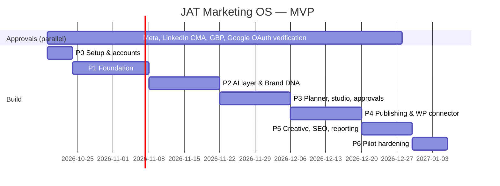

# G — MVP Implementation Roadmap

Assumes 1–2 developers working with Claude Code, ~12 weeks to pilot. Platform approvals run in parallel and gate channel adapters, not the schedule.

| Phase | Deliverables | Depends on | Exit criteria (testable) |
|---|---|---|---|
| **P0 — Setup** (1 wk) | Repo, CI, environments, platform app registrations & applications submitted, privacy/terms pages | — | CI green on empty build; all approval applications submitted with confirmation IDs logged |
| **P1 — Foundation** (3 wk) ← *started in this PR* | Monorepo; `core` (Brand DNA schema, claims, policy engine, state machine, linter, UTM, platform limits); `vault` (envelope encryption); `db` (schema, RLS migration, tenant-scoped transaction helper); audit log | P0 | Unit tests pass; **RLS test proves cross-tenant read/write is impossible**; vault round-trip & tamper tests pass; ≥ 90% line coverage on `core` |
| **P2 — AI & Brand DNA** (2 wk) | `ai` package (Claude client, structured outputs, caching, cost ledger, budget guard); crawler (robots-aware, ≤50 pages); PDF extraction; brand agent; Brand DNA diff & approval UI; Auth.js | P1 | Golden-fixture eval: 100% schema-valid, 0 un-sourced `extracted` fields on 5 fixture businesses; spend cap blocks calls when exceeded |
| **P3 — Plan, studio, approvals** (2 wk) | Planner agent; calendar views; post drafting; linter + QA agent; approval service with hash binding; client review portal (magic link) | P2 | E2E (Playwright): plan → draft → approve → edit invalidates approval; high-risk excluded from batch approve |
| **P4 — Publishing** (2 wk) | Worker with pg-boss; publisher with pause/idempotency/approval checks; **JAT Connector WP plugin** (HMAC, SEO meta for 3 plugins, snapshots, rollback); Facebook Pages + Bluesky adapters; export package; OAuth flows; token refresh jobs | P3 | Staging: 50 publishes to JAT-owned accounts with 0 duplicates under forced retries; WP rollback restores exact prior values on Yoast, Rank Math, AIOSEO test sites; pause stops queued jobs within 60 s |
| **P5 — Creative, SEO, reporting** (1.5 wk) | Template renderer (Playwright → PNG, platform crops); SEO snapshot (crawl, CrUX, PSI, GSC); monthly report generator | P4 | Rendered text matches source copy exactly (OCR check on fixtures); report shows "not available" for missing metrics |
| **P6 — Pilot hardening** (1 wk) | Security review (checklist in I); backup restore drill; load test; runbooks; onboard 3 pilots | P5 | Restore from backup < 1 h RPO 24 h; pen-test checklist complete; pilots live in Manual/Assisted mode |

## After MVP (P1 priorities)
Instagram, LinkedIn org and GBP adapters (as approvals land) → blog repurposing with derivative tracking → GA4 attribution → competitor monitoring → 60/90-day plans → analytics baselines. Autonomous mode only after the gate in `00-vision-review.md` §2 #3.
